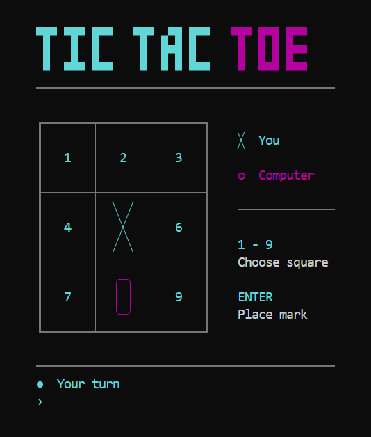

 

Kryziukai-Nuliukai.bat
======================

[Crosses and zeros (aka Tic-Tac-Toe, Noughts and crosses, Xs and Os)](https://en.wikipedia.org/wiki/Tic-tac-toe) game written in [Windows Batch](http://en.wikipedia.org/wiki/Batch_file) language and can be played in different languages.

Terminal appearance
===================

The board uses UTF-8 box-drawing characters. Colors are enabled by default. In the standard Windows console, a small PowerShell call enables ANSI support for the current console; if unavailable, the game falls back to plain text. Windows Terminal, ANSICON and ConEmu support colors directly. Run `kryz.bat /COLOR` to enable ANSI colors explicitly in another compatible terminal, or `kryz.bat /MONO` for plain text. The `NO_COLOR` environment variable disables automatic coloring; `/COLOR` explicitly opts back in.

X is cyan, O is magenta, the board is muted gray, and errors are red.

The screenshot shows actual game output rendered with xterm.js using a Windows console color palette.
